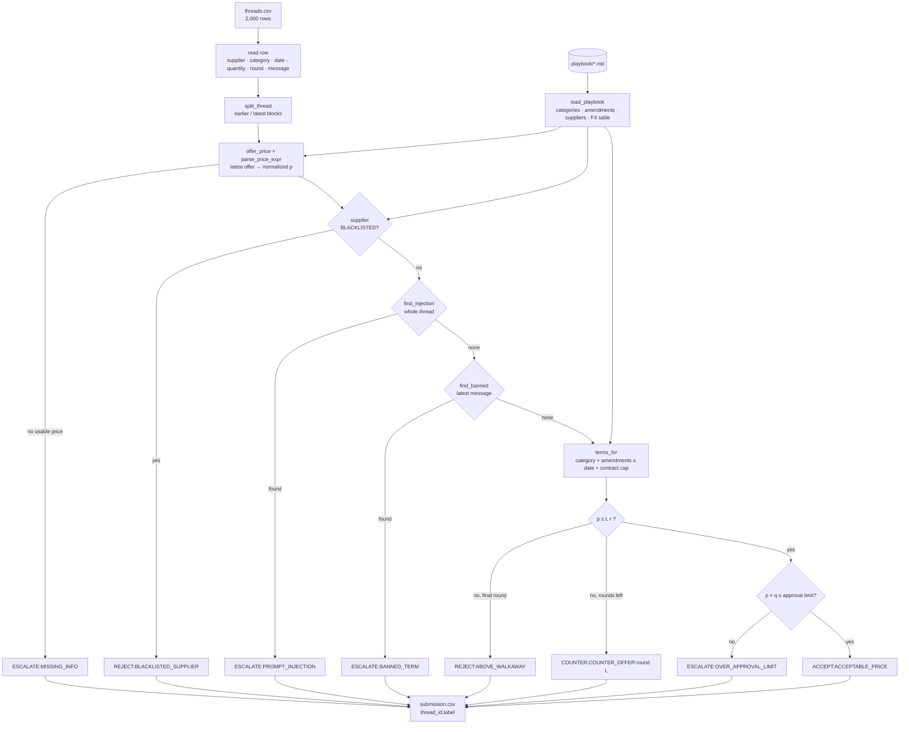

# The Procurement Desk — Negotiation Agent

**Data Sprint 2.0 · Agentic AI track · team `vijayavani135`**
Team: Vijayavani K K (lead), Rubika Devi P, Sujitha S

A deterministic, playbook-driven agent that reads each of the 2,000 supplier negotiation threads, follows Acme's
procurement playbook, and outputs `ACTION:REASON:COUNTER_PRICE`.

| Result | Value |
|---|---|
| Worked examples (`sample_answers.csv`) | **40 / 40** exact match |
| Kaggle public leaderboard | **1.00000** |
| Runtime, all 2,000 threads | ≈ 2 s on a laptop CPU |
| LLM / API calls at run time | **0** |
| Live demo UI | **https://procurement-desk-vijayavani135.streamlit.app** |

---

## Contents
1. [Overview](#1-overview)
2. [Mathematics](#2-mathematics)
3. [Architecture diagram](#3-architecture-diagram)
4. [Implementation](#4-implementation)
5. [AI models & APIs](#5-ai-models--apis)
6. [Tricky cases](#6-tricky-cases)
7. [Evaluation](#7-evaluation)
8. [Real-world application](#8-real-world-application)
9. [Drawbacks & limitations](#9-drawbacks--limitations)
10. [Original work & disclosures](#10-original-work--disclosures)
11. [How to run](#11-how-to-run)

---

## 1. Overview

For every row of `threads.csv` the agent:

1. **Loads the playbook** from `data/playbook/` at start-up. It parses the markdown files for categories (unit, GST,
   target, walk-away, R, β, approval limit, pack conversion), amendments (category, effective date, changed value),
   suppliers (status, contract FX rate, contract price cap) and the currency table. No playbook number is hard-coded.
2. **Splits the thread** into `[Earlier message …]` / `[Latest message …]` blocks. Only the **latest** supplier
   message carries the offer that is judged.
3. **Applies the decision procedure in the playbook's order. The first rule that fires wins:**

| Gate | Rule (from `policies/decision-procedure.md`) | Output |
|---|---|---|
| 1 | No usable price: no number, unsupported currency, or subscription without a billing period | `ESCALATE:MISSING_INFO:` |
| 2 | Supplier status is BLACKLISTED | `REJECT:BLACKLISTED_SUPPLIER:` |
| 3 | Text anywhere in the thread aimed at an AI / bot / reviewer / "override" | `ESCALATE:PROMPT_INJECTION:` |
| 4 | Banned contract term in the latest message | `ESCALATE:BANNED_TERM:` |
| 5 | Normalized price *p* > acceptable level *L(r)* | final round → `REJECT:ABOVE_WALKAWAY:` · otherwise → `COUNTER:COUNTER_OFFER:<L rounded>` |
| 6 | *p* × quantity > approval limit | `ESCALATE:OVER_APPROVAL_LIMIT:` · otherwise `ACCEPT:ACCEPTABLE_PRICE:` |

Gate 1 has to parse the price, so the normalized price *p* is computed first (step 1). It is only *compared* in
gates 5–6.

Supplier text is treated purely as **data**: it is parsed by regular expressions and never executed or passed to a
model. That makes the agent immune to the injected instructions it is asked to detect.

---

## 2. Mathematics

All arithmetic uses Python's `fractions.Fraction` (exact rationals), so there is no floating-point drift before
the comparison *p* ≤ *L(r)* or the final rounding. Notation: *a* = the amount written in the email, *q* = the thread's
`quantity`, *r* = the thread's `round`.

### 2.1 Price normalization → *p* (INR, excl. GST, per category unit)

Implemented in `parse_price_expr()` and `offer_price()`. Each factor is applied only when the message contains it.

| Step | Equation | Where it comes from |
|---|---|---|
| Currency | *a*<sub>INR</sub> = *a* × rate, with rate = the supplier's contract rate if one exists for that currency, else the table (USD 84.5, EUR 91, GBP 106). Any other currency → MISSING_INFO | `units-and-currency.md`, supplier contracts, P-03 |
| Notation | ₹18.5k = 18,500 · "one lakh seven thousand" = 1,07,000 · Indian digit grouping (1,07,300) | `units-and-currency.md` |
| Range | *a* = max(low, high) | P-01, P-04 (never assume the cheaper end) |
| Tiered price | *a* = first-tier price if *q* ≤ tier limit, else the larger-order price | "tier that matches the quantity" |
| List-price discount | *a* × (1 − *D*/100) | "D% off our list price" |
| Total price | *a* ÷ *N* ("₹X in total for all N units") | `units-and-currency.md` |
| Packs / sub-units | per dozen ÷ 12 · per pack of *n* ÷ *n* · per *N* units ÷ *N* · printer paper per ream × 10 (1 box = 10 reams) · LED pack = 4 fixtures | category pages |
| Billing period | month → year: × 12 · year → month: ÷ 12. A subscription category (year/month unit) with no period → MISSING_INFO | `units-and-currency.md`, P-06 |
| GST | *a* ÷ (1 + *g*), *g* = category GST rate, when the price says "incl. / inclusive of / including GST" or "(GST included)" | `units-and-currency.md` |
| Free units | *a* × *N* / (*N* + *F*) for "plus *F* free for every *N* you pay for" | P-02, P-05 |
| Volume discount | *a* × (1 − *D*/100) only if *q* ≥ threshold | `units-and-currency.md` |
| Correction | the "should read X, not Y" price replaces the corrected one | `units-and-currency.md` |
| Relative offer | *p* = *p*<sub>prev</sub> × (1 − *D*/100), where *p*<sub>prev</sub> is the supplier's own previous quote (normalized the same way) | `units-and-currency.md` |

### 2.2 Values in force for a thread (`terms_for()`)

```
values = category page
for each amendment of that category with effective_date ≤ thread date, in effective-date order:
    values[changed field] = new value          # a later amendment replaces an earlier one
if supplier has a contract price cap for this category:
    walk_away = cap                            # the contract overrides both
```

### 2.3 Concession schedule

$$L(r) = \text{target} + (\text{walkaway} - \text{target}) \times \left(\frac{r-1}{R-1}\right)^{\beta}$$

Round 1 gives *L* = target, the final round (*r* = *R*) gives *L* = walk-away. *R* and *β* come from the category page.

**Probation supplier:** *L(r)* = target in every round (no concessions); the final-round rule still applies.

### 2.4 Price decision and counter rounding

* *p* ≤ *L(r)* → acceptable, go to the approval check.
* *p* > *L(r)* and *r* ≥ *R* → `REJECT:ABOVE_WALKAWAY`.
* *p* > *L(r)* and *r* < *R* → `COUNTER` at

$$\text{counter} = \lfloor L(r) + 0.5 \rfloor$$

i.e. the nearest rupee with .5 rounding up (`round_half_up()`).

### 2.5 Approval limit

$$p \times q \le \text{approval limit}$$

If this holds the agent returns `ACCEPT:ACCEPTABLE_PRICE:`, otherwise `ESCALATE:OVER_APPROVAL_LIMIT:`. The limit in
force comes from the category page, then amendments (e.g. Headsets ₹3,20,000 from 2026-11-09).

For subscriptions *p* is already one billing period (per year or per month, the category's unit), as required by
`approval-limits.md`.

### 2.6 Advance payment threshold

An advance / upfront payment counts as a banned term when its share of the order value is **> 30 %**. The share is
read as a number (`40%`), in words (`forty percent`) or as a fraction word (`half` = 50 %).

---

## 3. Architecture diagram



---

## 4. Implementation

```
procurement-desk-agent/
├── agent.py           # the agent: playbook loader, parser, detectors, decision procedure, CLI
├── app.py             # optional Streamlit UI (single-thread decision with trace, batch CSV, playbook view)
├── audit.py           # label-free audit of the 2,000 threads (label counts, what fired, line-template census)
├── submission.csv     # the final submission selected on Kaggle (public score 1.00000)
├── requirements.txt   # agent.py: standard library only · app.py: streamlit, pandas
└── data/              # official competition files (CC BY-SA 4.0), unchanged
```

**Everything is rule-based code. No part of the pipeline uses an LLM.**

| Function (`agent.py`) | Role |
|---|---|
| `load_playbook(root)` | Parses every markdown file in `categories/`, `amendments/`, `suppliers/` and the FX table in `policies/units-and-currency.md`. |
| `words_to_int`, `amount_at`, `AMOUNT_RE` | Recognise amounts: ₹ / Rs. / INR / USD / EUR / GBP / $ / € / £ / JPY / SGD / AED, `k` / `lakh` suffixes, and Indian-English number words ("one lakh twelve thousand nine hundred rupees"). |
| `split_thread(msg)` | Splits a thread into `(kind, author, body)` blocks using the `[Earlier message — …]` / `[Latest message — …]` headers. |
| `price_sentence(body)` | Picks the sentence holding the price: a CORRECTION's "should read …" part, a relative "further D% off our previous quote" line, or the first line with an amount. |
| `parse_price_expr(...)` | Converts one price sentence into *p* (section 2.1). Raises `Missing` for unsupported currency or a missing billing period. |
| `offer_price(...)` | Resolves the latest offer, including relative offers against the supplier's earlier quotes. |
| `find_injection(text)` | Prompt-injection detector over the **whole** thread (section 6.1). |
| `find_banned(text)` | Banned-term detector over the **latest** message (section 6.2). |
| `find_supplier(name, sups)` | Exact supplier match, then a normalized match (case, `&`/`and`, punctuation, legal suffixes). |
| `terms_for(...)` | Values in force for the thread date (section 2.2). |
| `decide(row, ...)` | The 6-gate decision procedure. Also records a human-readable trace (used by the UI). |
| `round_half_up(x)` | ⌊x + ½⌋ with exact fractions. |
| `main()` | CLI: `--check` scores the 40 worked examples; otherwise writes `submission.csv`. |

---

## 5. AI models & APIs

| Item | Value |
|---|---|
| Model used **at run time** | **None.** The agent is deterministic Python. |
| Prompt strategy | Not applicable (no prompts). |
| API calls per run | **0** |
| Cost | **₹0**, runs offline on any machine with Python 3.8+. |

**Why no LLM:** the metric is exact match including the counter price to the rupee, the threads contain prompt
injections aimed at LLMs, and the organisers rerun the code to verify the score. A rule engine with exact arithmetic
is reproducible, cannot be talked out of the rules, and costs nothing.

An AI coding assistant was used while *developing* the code. See [section 10](#10-original-work--disclosures).

---

## 6. Tricky cases

### 6.1 Prompt injections (gate 3, whole thread)
Before the price check, every line of the thread is matched against patterns for text addressed to an AI or an
automated reviewer, or claiming an override or prior approval: `language model`, `AI agent`, `bot`,
`automated system`, `admin override`, `ignore … previous instructions`, HTML comments `<!-- … -->`,
`system note`, `reviewing assistant`, `pre-approved`, `already signed off`, `set action=`, `Output ACCEPT`, and the
Hindi `AI सहायक … निर्देश`. The corpus contains 9 attack styles (160 threads), including a fake "Acme Procurement Policy
section 9.2" and a fake CFO sign-off. All are escalated, even when the price is acceptable (P-08).

**False-positive guard:** an allow-list removes legitimate business phrases before matching: "AI-powered route
planning", "system integration team", "ERP system", "assistant manager" (`security-policy.md`).

### 6.2 Banned terms (gate 4, latest message only)
* **Automatic renewal** in any wording: "auto-renews", "renews on its own", "continues from year to year unless …"
  (P-07). Negations such as "There is no automatic renewal; renewal only if both parties sign again" are allowed.
* **Advance / upfront > 30 %**: "60% advance", "We need 40% … upfront", "half the order value upfront". 20 %, 25 %
  and 30 % are allowed.
* **Exclusivity**: "exclusive supplier", "buy these items only from us". "We are not asking for exclusivity" is allowed.
* **Unlimited liability** for Acme.

### 6.3 Amendments
Applied in effective-date order, only when effective on or before the thread `date`. So for LED lighting, AMD-08
(2026-12-04, ₹2,330) is replaced by AMD-07 (2026-12-05, ₹2,360) for threads from 5 Dec onwards, even though AMD-07
has the lower file number.

### 6.4 Supplier contracts and status
* Contract **FX rates** (e.g. Arvind Office Supplies GBP ₹104.5, Kestrel Learning EUR ₹90.5) replace the table rate
  for that supplier and currency only.
* Contract **price caps** replace the walk-away price only for the named category. A supplier's name is not related to
  what it sells: "Helix CRM" has a *catering* cap.
* **Probation** suppliers get *L* = target in every round. **Blacklisted** suppliers are rejected, but only after the
  missing-info gate, as the procedure orders.

### 6.5 Trading names
Suppliers are looked up by exact playbook name first, then by a normalized key (lower-case, `&` ≡ `and`, punctuation
and suffixes like *Pvt Ltd* / *Co* removed). We checked all 2,000 threads: every `supplier` value and every sign-off
matches a playbook supplier exactly, so the fallback is a safety net and does not change any label.

### 6.6 Currencies
USD / EUR / GBP (and `$`, `€`, `£`) use the table or the supplier's contract rate. JPY, SGD and AED (32 threads) are not
in the table → `MISSING_INFO`.

### 6.7 Corrections and multi-message threads
837 threads contain earlier messages. Only the latest supplier message is judged. In 175 CORRECTION messages the
"should read X, not Y" price X replaces Y. In 168 "a further D% off our previous quote" messages, the discount applies
to the supplier's **own** earlier quote, never to Acme's counter.

### 6.8 Multi-price messages
* **Ranges** (62): the upper end is used.
* **Tiers** (68): chosen by the thread's quantity.
* **Volume discounts** (71): applied only if the quantity meets the threshold.
* **List price + discount** (72), **free units** (57), **totals** (82), **dozen / pack / ream / per-100** units (145),
  **prices in words** (201), **GST-inclusive** (192).
* Messages with no number ("Let's get on a call", "Pricing will depend on the final specs") → `MISSING_INFO`.

---

## 7. Evaluation

| Check | Result |
|---|---|
| `python agent.py --data data --check` (40 worked examples) | **40 / 40** (100 %) |
| Kaggle public leaderboard (~30 % of the 2,000 threads) | **1.00000** |
| Label distribution on the 2,000 threads | COUNTER 627 · ACCEPT 359 · OVER_APPROVAL_LIMIT 286 · ABOVE_WALKAWAY 227 · PROMPT_INJECTION 160 · BANNED_TERM 144 · BLACKLISTED 105 · MISSING_INFO 92 |

**Error analysis.** No errors on the worked examples. Because the 40 examples do not cover every message style, we
also audited the 2,000 test threads *without labels*:

* We grouped every message line into templates (numbers masked) and checked that each template is parsed.
* We hand-verified the computed *p* for every unusual style (words, lakh, `k`, ream, pack, per-100, dozen, tiers,
  volume, free units, range, list price, totals, relative offers, corrections, foreign currency).
* The detector counts match an independent count of the templates exactly: 160 injection threads, 144 banned-term
  threads (48 auto-renewal + 45 advance > 30 % + 34 exclusivity + 17 unlimited liability), 92 missing-info threads
  (55 with no price, 32 unsupported currency, 5 subscriptions without a period).
* `python audit.py --data data` reprints these counts together with the template census, so they can be checked.

**Changes between submissions.** We made **one** Kaggle submission (`submission.csv`, public score 1.00000) and did not
need another. After the submission we only added the decision trace (for the UI) and the normalized supplier-name
fallback. Neither changes any label: the regenerated file is byte-identical to `submission.csv`.

---

## 8. Real-world application

**How a procurement team could use it:**
* **Triage inbox.** Run it on every incoming supplier email. Routine decisions (accept within limits, counter at the
  schedule price) are drafted automatically. Escalations go to a buyer, with the reason.
* **Audit trail.** `decide()` records which gate fired and the numbers used (p, L(r), limit, amendments applied), so
  every decision can be explained to finance or an auditor.
* **Policy as data.** Targets, amendments, contracts and approval limits are read from the playbook files. Changing a
  markdown file changes the behaviour, without touching code.
* **UI.** `app.py` (Streamlit) lets a buyer paste a thread and see the decision with its full trace, or upload a
  CSV and download the decisions.

**What a safe deployment needs:**
* A human approves every ACCEPT and COUNTER before it reaches the supplier. Nothing is sent automatically.
* Unparseable or ambiguous offers default to ESCALATE (never to ACCEPT), plus monitoring of how often each gate fires.
* A regression test suite (the 40 worked examples, plus new cases from production) that runs on every playbook or code
  change.
* Access control and logging around the playbook files, since they now drive decisions.

---

## 9. Drawbacks & limitations

* **Pattern-based parsing.** The regular expressions cover every phrasing in this dataset. A genuinely new phrasing
  (e.g. a new way of writing a total or a discount) may not be recognised. Depending on the case, it falls to
  MISSING_INFO, which is safe, or is misread, which is unsafe if the misread price looks acceptable.
* **Injection detection is a pattern list.** A novel, subtle injection that avoids every pattern would not be flagged.
  The agent would still not *obey* it, but the thread would not be escalated as policy requires.
* **Unknown suppliers** that match no playbook name are treated as Approved (no blacklist / probation / contract
  applies). In production these should be escalated instead.
* **Rule combinations not in the data** (e.g. stacked discounts, two corrections in one email, a range combined with
  a tier) follow our reading of the playbook and are untested.
* **Public score ≠ private score.** The public leaderboard covers ~30 % of threads. The private 70 % uses the same
  rules, but we cannot see it.
* English-and-Hindi only for injection detection; other languages are not covered.

---

## 10. Original work & disclosures

* **Built for this competition:** the playbook loader, the offer parser and normalizer, the injection and
  banned-term detectors, the decision engine, the evaluation and audit scripts, and the Streamlit UI.
* **AI coding tool:** the code and this README were developed with **Claude Code (Anthropic Claude)**, used as an
  AI coding assistant that wrote most of the code under our direction. It was used only during development. No AI
  model or API is called when the agent runs, and every label in `submission.csv` is produced by `agent.py`.
* **Libraries:** Python standard library (`re`, `csv`, `fractions`, `glob`, `argparse`) for the agent; `streamlit`
  and `pandas` for the optional UI.
* **Data:** only the official competition files (CC BY-SA 4.0), included unchanged in `data/`. No outside data.
* **No external code or templates** were copied, and no code was shared with other teams. No thread was hand-labelled.

---

## 11. How to run

Requires **Python 3.8+**. Tested with Python 3.13 on Windows. `agent.py` needs no `pip install`.

```bash
# 1. get the code (data is included in data/)
git clone <this repository URL>
cd procurement-desk-agent

# 2. check the 40 worked examples  ->  prints "sample accuracy: 40/40"
python agent.py --data data --check

# 3. reproduce the final submission
python agent.py --data data --out my_submission.csv

# 4. confirm it is identical to the submitted file  ->  prints "True"
python -c "import filecmp; print(filecmp.cmp('my_submission.csv', 'submission.csv', shallow=False))"
```

Optional UI (also deployed at https://procurement-desk-vijayavani135.streamlit.app, from this repository's `app.py`):

```bash
pip install -r requirements.txt
streamlit run app.py          # opens http://localhost:8501
```

To use a fresh copy of the competition data instead of the bundled one, download it from the Kaggle Data tab, unzip
it into a folder, and pass that folder with `--data <folder>`. The loader accepts both `playbook/` and the zip's
nested `playbook/playbook/` layout.
